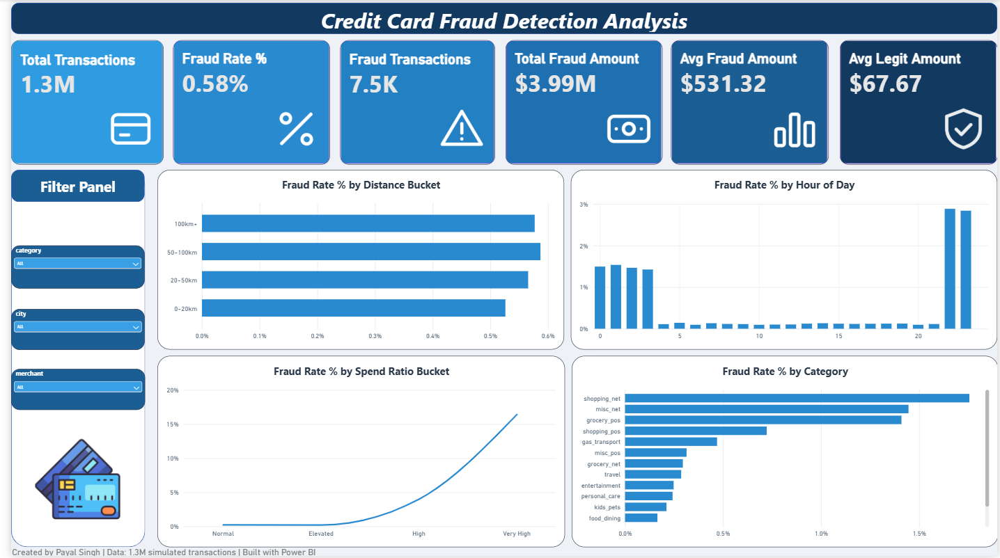
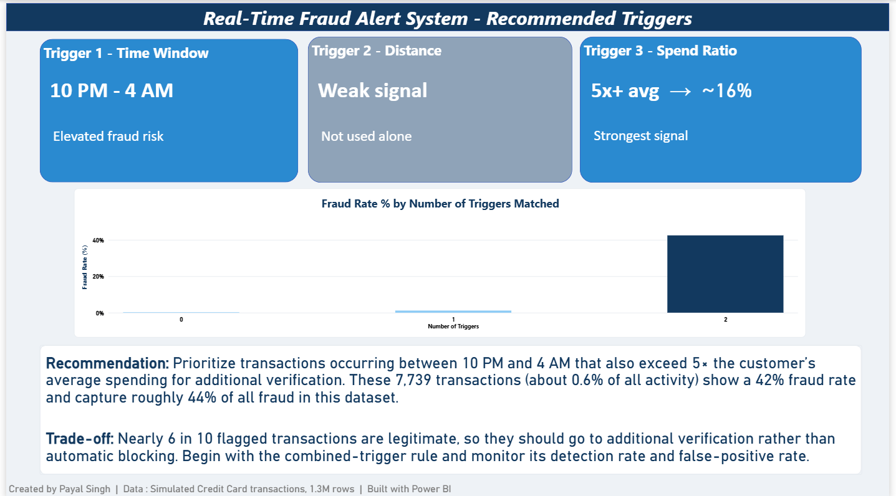

# Credit Card Fraud Detection Dashboard

## Overview

This is my first Power BI project. It is a 2-page dashboard built on 1,296,675 credit card transactions, of which 7,506 are fraud (0.58%). Page 1 shows the overall picture of fraud: how much there is, when it happens, and where. Page 2 turns what I found into a simple rule that a bank could use to flag risky transactions.

## Business Question

Which transaction patterns consistently signal fraudulent behaviour, and what triggers should be set in a real-time fraud alert system?

## Dashboard

Page 1: Overview



Page 2: Alert system



## Data

The data is the "Credit Card Transactions Fraud Detection Dataset" on Kaggle(https://www.kaggle.com/code/samahfetouh/credit-card-transactions-fraud-detection/output).It is a simulated dataset, not real customer data. It was generated with a tool called Sparkov and covers 1 January 2019 to 31 December 2020. I used the training file. I did not upload the data to this repository.

## Key Insights

1. **Fraud is rare but expensive.** Only 0.58% of transactions are fraud, but they add up to $3.99M. The average fraud transaction is $531.32, while the average normal one is $67.67, about 8 times smaller.
2. **Amount compared to the customer's normal spending is the strongest signal.** The fraud rate goes up steeply as a transaction gets bigger compared to the customer's average. It reaches 16.4% when the amount is 5 times the average or more.
3. **Late night is risky.** The fraud rate is about 1.5% from midnight to 3 AM and about 3% at 10 PM and 11 PM. During the day it is very low.
4. **Distance does not help.** The fraud rate is about 0.5% to 0.6% in every distance group, almost the same as the overall rate. I expected far-away purchases to be riskier, but the data did not show it.
5. **Some categories are riskier.** Online shopping, online misc and in-store grocery have the highest fraud rates.
6. **Two signals together work better than one.** Transactions that are both late at night and 5 times the customer's average have a 42% fraud rate. More on this below.

## The Alert Rule I Suggest

Flag a transaction if it happens between 10 PM and 4 AM and the amount is 5 times the customer's average or more.

This is what the rule gives on this data:

- It flags 7,739 transactions, about 0.6% of all transactions
- 3,287 of them are really fraud, so 42% of flagged transactions are fraud
- That is about 44% of all the fraud in the data (3,287 out of 7,506)
- When only one of the two conditions matches, the fraud rate is about 1%. When neither matches, it is under 0.5%
- The other 4,452 flagged transactions are normal purchases, so nearly 6 out of 10 alerts would be false alarms

Because of the false alarms, I would send flagged transactions for an extra check, like asking the customer to confirm, instead of blocking them straight away.

## Tools and Techniques

**Tools**

- Power BI Desktop for the dashboard
- DAX for measures and calculated columns
- Kaggle for the data, GitHub and Google Drive to share the project

**Techniques**

- Calculated measures for fraud rate, fraud counts, total fraud amount and the average fraud and normal amounts
- Grouping into buckets (distance groups and "spend compared to average" groups) using SWITCH
- A hidden helper column to put the buckets in the right order
- A combined risk score from 0 to 2, with one point for the night rule and one point for the 5x rule
- Comparing fraud rates across time, amount, distance and category
- Checking a rule by how much fraud it catches and how many false alarms it creates
- Dashboard design: KPI cards, bar, column and line charts, slicers, a custom blue colour theme, and a business recommendation on the last page

```dax
Fraud Rate % =
DIVIDE(
    CALCULATE(COUNTROWS('powerbi_train'), 'powerbi_train'[is_fraud] = 1),
    COUNTROWS('powerbi_train')
)

Amount vs Avg Ratio =
DIVIDE('powerbi_train'[amt], 'powerbi_train'[customer_avg_amt])

Combined Risk Flag =
IF(OR('powerbi_train'[hour] >= 22, 'powerbi_train'[hour] <= 3), 1, 0)
    + IF('powerbi_train'[Amount vs Avg Ratio] >= 5, 1, 0)
```

## What Was Hard and What I Learned

- Putting groups like 0-20km, 20-50km and 50-100km in the right order took me a while. A text column sorts alphabetically, so I made a hidden number column to control the order.
- At one point every bar in a chart showed 100%. The cause was a "show value as percent of grand total" setting on the chart, not my numbers.
- Distance not working was a surprise. I expected purchases far from home to be riskier, but the data said no, so I did not use it.

## Limits

- I chose the 10 PM to 4 AM window and the 5x amount by looking at this same data, so the rule probably looks better here than it would on new data. I have not tested it on separate data.
- `customer_avg_amt` is the average over each customer's whole history in the dataset. A real system would only know the earlier transactions.
- This is an analysis with simple rules, not a machine learning model.
- The data is simulated, so the patterns I found, like fraud being higher late at night, show how this dataset was generated. They may not match what happens with real customers.

## What I Would Do Next

- Test the rule on data it has not seen
- Try a simple model, like logistic regression, and compare it with my rule
- Use a rolling average of earlier transactions instead of the whole-history average

## Files

- `README.md`
- `page1_executive_overview.png` and `page2_alert_system.png`: screenshots of the dashboard
[Download the Power BI file (https://drive.google.com/file/d/1nUfR1eiCikIAuldd3ZW6tUmkdpysvdnl/view?usp=drive_link)]

## Author

Payal Singh. I am learning data analysis and looking for a data analyst role. [https://www.linkedin.com/in/payal-singh-6261b526a/]

